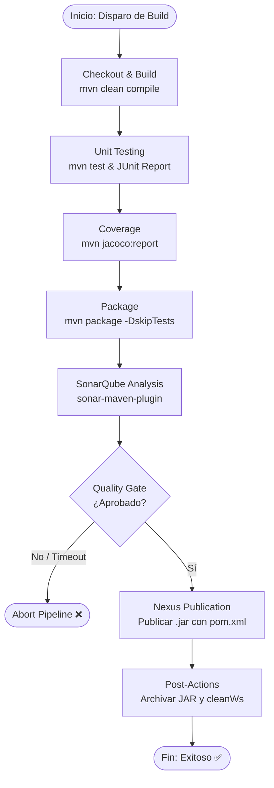
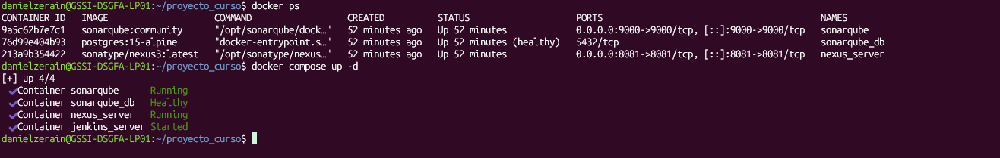
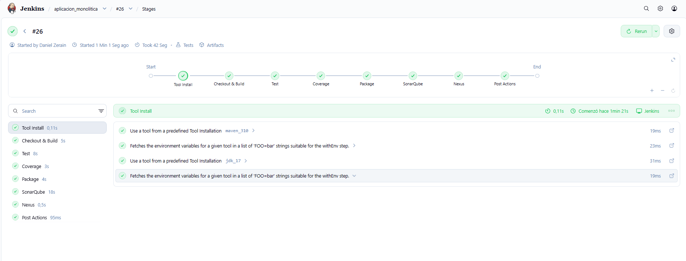
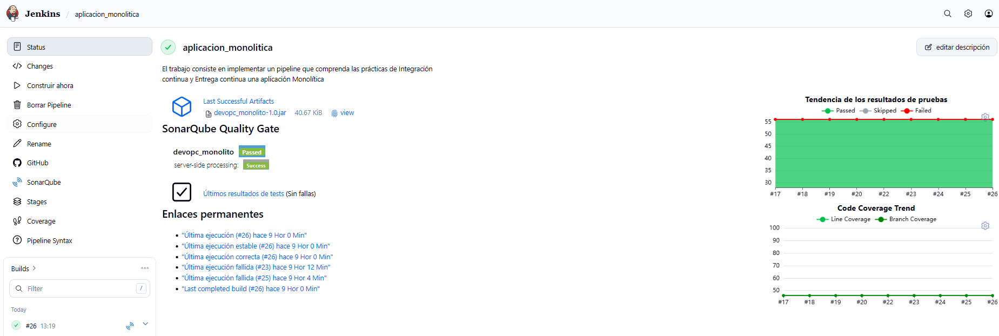
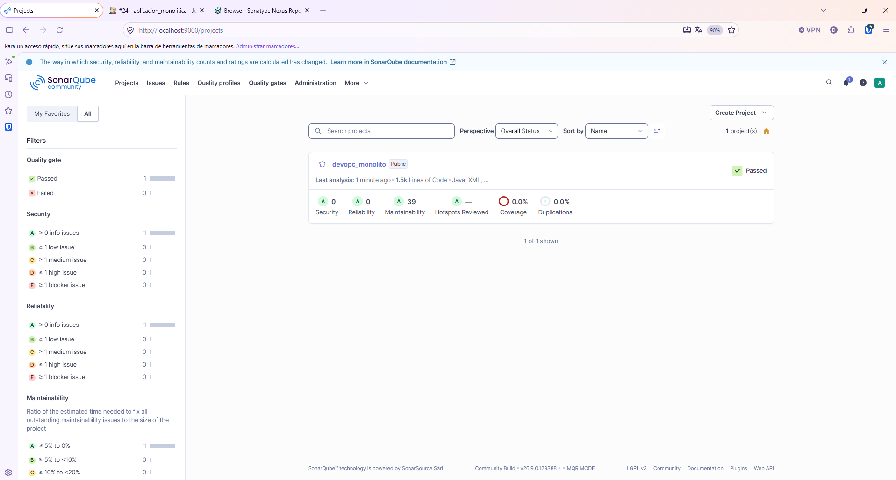
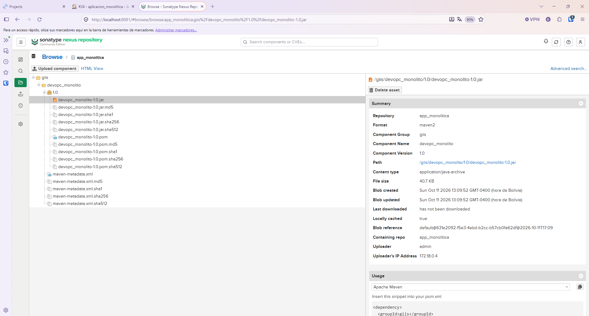

# Curso: DevSecOps Engineer
# Trabajo Práctico: Pipeline CI/CD con Jenkins para Aplicación Monolítica
**Proyecto de:** Daniel Zerain Medinaceli

**Repositorio:** [danielzerain/devops_monolito](https://github.com/danielzerain/devops_monolito.git)  
**Rama principal:** `main`  
**Tecnologías clave:** Docker, Docker Compose, Jenkins (Declarative Pipeline), Java 17, Apache Maven, JUnit, JaCoCo, SonarQube, Sonatype Nexus.
---

## 1. Introducción y Objetivos

El objetivo de este trabajo práctico es diseñar, implementar y automatizar un pipeline de **Integración Continua y Entrega Continua (CI/CD)** para una aplicación monolítica en Java utilizando **Jenkins Declarativo**. 

El flujo garantiza:
- Compilación y validación automática del código fuente desde GitHub.
- Ejecución de pruebas unitarias y generación de reportes de cobertura de código.
- Análisis estático de código y cumplimiento de criterios de calidad mediante **Quality Gates** en SonarQube.
- Generación, archivado y publicación versionada de artefactos binarios (`.jar`) en un repositorio empresarial (**Sonatype Nexus**).
- Aislamiento e higiene del entorno de ejecución en cada build.

---

## 2. Arquitectura del Flujo CI/CD

El siguiente diagrama detalla la secuencia de ejecución de las fases del pipeline:


El archivo que contiene todo el pipeline es el `Jenkinsfile`

```yaml
pipeline {
    agent any
    tools {
        maven 'maven_310'
        jdk 'jdk_17'
    }
    environment {
        HOME = "${WORKSPACE}"
        NEXUS_CREDENTIALS = credentials('nexus_user')
    }   
    stages {
        stage('Build') {
            steps {
                git branch: 'main', url: 'https://github.com/danielzerain/devops_monolito.git'
                sh 'mvn clean compile -B -ntp'
            }
        }
        stage('Test') {
            steps {
                sh 'mvn test -B -ntp'
            }
            post {
                success {
                    junit 'target/surefire-reports/*.xml'
                }
            }
        }
        stage('Coverage') {
            steps {
                sh 'mvn jacoco:report -B -ntp'
            }
            post {
                success {
                    recordCoverage(tools: [[parser: 'JACOCO']])
                }
            }
        }
        stage('Package') {
            steps {
                sh 'mvn package -DskipTests -B -ntp'
            }
        }
        stage('SonarQube') {
            steps {
                withSonarQubeEnv('sonarqube'){
                    sh 'env | sort'
                    script {
                        sh 'mvn org.sonarsource.scanner.maven:sonar-maven-plugin:sonar'
                    }
                }
            }
        }
        stage("Quality Gate"){
            steps{
                timeout(time: 1, unit: 'MINUTES') {
                    waitForQualityGate abortPipeline: true
                }
            }
        }
        stage('Nexus') {
            steps {
                script {

                    sh 'env | sort'

                    def pom = readMavenPom file: 'pom.xml'
                    println pom

                    nexusPublisher nexusInstanceId: 'nexuscd',
                    nexusRepositoryId: 'app_monolitica',
                    packages: [[$class: 'MavenPackage',
                        mavenAssetList: [
                            [
                                classifier: '', 
                                extension: '', 
                                filePath: "target/${pom.artifactId}-${pom.version}.${pom.packaging}"
                            ]
                        ],
                        mavenCoordinate: [
                            groupId: "${pom.groupId}",
                            artifactId: "${pom.artifactId}",
                            packaging: "${pom.packaging}",
                            version: "${pom.version}"
                        ]
                    ]]
                }
            }
        }  
    }
    post {
        always {
            archiveArtifacts artifacts: 'target/*.jar', fingerprint: true
        }
        cleanup {
            cleanWs()
        }
    }
}

```

[Archivo Jenkinsfile del Proyecto](proyecto/Jenkinsfile)

---

## 3. Infraestructura y Servicios con Docker Compose

Toda la plataforma y herramientas de soporte para el ciclo CI/CD (Jenkins, SonarQube con base de datos PostgreSQL y Sonatype Nexus) se despliegan y gestionan de forma contenerizada mediante **Docker** y **Docker Compose**. Esto garantiza un entorno de ejecución aislado, reproducible y comunicado a través de una red tipo bridge dedicada (`ci_cd_network`).

A continuación, se detalla el archivo de orquestación `docker-compose.yml` utilizado:

```yaml
services:
  jenkins:
    image: jenkins/jenkins:jdk25
    container_name: jenkins_server
    user: "1000:1000"
    ports:
      - "8080:8080"
      - "50000:50000"
    environment:
      - TZ=America/La_Paz
      - JAVA_OPTS=-Djenkins.install.runSetupWizard=true
    volumes:
      - ./project_drive/jenkins_data:/var/jenkins_home
      - /var/run/docker.sock:/var/run/docker.sock
    networks:
      - ci_cd_net

  nexus:
    image: sonatype/nexus3:latest
    container_name: nexus_server
    ports:
      - "8081:8081"
    environment:
      - TZ=America/La_Paz
      - INSTALL4J_ADD_VM_PARAMS=-Xms1200m -Xmx1200m -XX:MaxDirectMemorySize=1024m
    volumes:
      - nexus_data:/nexus-data
    networks:
      - ci_cd_net

  sonarqube:
    image: sonarqube:community
    container_name: sonarqube
    depends_on:
      db:
        condition: service_healthy
    ports:
      - "9000:9000"
    environment:
      - SONAR_JDBC_URL=jdbc:postgresql://db:5432/sonar
      - SONAR_JDBC_USERNAME=sonar
      - SONAR_JDBC_PASSWORD=sonar_secure_password
    volumes:
      - sonarqube_data:/opt/sonarqube/data
      - sonarqube_extensions:/opt/sonarqube/extensions
      - sonarqube_logs:/opt/sonarqube/logs
    ulimits:
      nofile:
        soft: 65536
        hard: 65536
    networks:
      - ci_cd_net

  db:
    image: postgres:15-alpine
    container_name: sonarqube_db
    environment:
      - POSTGRES_USER=sonar
      - POSTGRES_PASSWORD=sonar_secure_password
      - POSTGRES_DB=sonar
    volumes:
      - postgresql_data:/var/lib/postgresql/data
    healthcheck:
      test: ["CMD-SHELL", "pg_isready -U sonar -d sonar"]
      interval: 10s
      timeout: 5s
      retries: 5
    networks:
      - ci_cd_net

networks:
  ci_cd_net:
    name: ci_cd_network
    driver: bridge

volumes:
  nexus_data:
    name: nexus_data
  sonarqube_data:
  sonarqube_extensions:
  sonarqube_logs:
```


### 3.1. Descripción de los Contenedores
- **`jenkins` (`jenkins_server`)**: Servidor principal de automatización de CI/CD (Jenkins con JDK 25). Expone los puertos `8080` (interfaz gráfica) y `50000` (comunicación con agentes). Mapea el socket Docker del host (`/var/run/docker.sock`) para permitir la ejecución de contenedores y monta `./project_drive/jenkins_data` para persistencia.
- **`nexus` (`nexus_server`)**: Repositorio de artefactos Sonatype Nexus 3 expuesto en el puerto `8081`, con parámetros de JVM ajustados para consumo óptimo de memoria y persistencia en el volumen `nexus_data`.
- **`sonarqube` (`sonarqube`)**: Plataforma de análisis estático de código y Quality Gates expuesta en el puerto `9000`. Depende del contenedor de base de datos (`db`), iniciando solo tras su verificación satisfactoria.
- **`db` (`sonarqube_db`)**: Base de datos PostgreSQL 15 encargada de almacenar proyectos, usuarios y métricas históricas de SonarQube, equipada con *healthcheck* (`pg_isready`).
- **Red `ci_cd_network`**: Red interna tipo *bridge* que permite a los contenedores comunicarse entre sí mediante sus nombres de host internos.

---

## 4. Requisitos y Configuración Previa en Jenkins

Para la correcta ejecución del pipeline, se requieren las siguientes configuraciones previas en la instancia de Jenkins:

### 4.1. Herramientas Globales (*Global Tool Configuration*)
- **JDK:** Configurado con el identificador `jdk_17` (OpenJDK 17).
- **Maven:** Configurado con el identificador `maven_310` (Apache Maven 3.x).

### 4.2. Plugins Requeridos
- **Pipeline** y **Git Plugin**
- **JUnit Plugin** (publicación de resultados de pruebas).
- **Code Coverage Plugin** (integración y métricas de JaCoCo).
- **SonarQube Scanner Plugin** (integración con servidor SonarQube y webhooks de Quality Gate).
- **Pipeline Utility Steps** (lectura dinámica de `pom.xml` con `readMavenPom`).
- **Nexus Artifact Uploader Plugin** (`nexusPublisher`).

### 4.3. Credenciales y Servidores Conectados
- **Credencial de Nexus:** Credencial de tipo usuario/contraseña con ID `nexus_user`.
- **Servidor SonarQube:** Instancia configurada en *Manage Jenkins > System* bajo el nombre `sonarqube`.
- **Instancia de Nexus:** Servidor configurado con el identificador `nexuscd` y repositorio destino `app_monolitica`.

---

## 5. Estructura y Explicación Detallada del `Jenkinsfile`

### 5.1. Configuración Global (`agent`, `tools`, `environment`)
```groovy
pipeline {
    agent any
    tools {
        maven 'maven_310'
        jdk 'jdk_17'
    }
    environment {
        HOME = "${WORKSPACE}"
        NEXUS_CREDENTIALS = credentials('nexus_user')
    }
```
- **`agent any`**: Permite la ejecución en cualquier ejecutor disponible dentro del clúster de Jenkins.
- **`tools`**: Inyecta en el `PATH` las versiones exactas de Maven 3.10 y Java 17 administradas centralmente.
- **`environment`**:
  - `HOME = "${WORKSPACE}"`: Asegura que Maven y herramientas auxiliares utilicen el directorio de trabajo como directorio base para cachés y configuraciones temporales.
  - `NEXUS_CREDENTIALS`: Carga de forma segura las credenciales de Nexus sin exponerlas en texto plano en los scripts.

---

### 5.2. Etapas del Pipeline (`stages`)



#### Stage 1: Build (Compilación)
```groovy
stage('Build') {
    steps {
        git branch: 'main', url: 'https://github.com/danielzerain/devops_monolito.git'
        sh 'mvn clean compile -B -ntp'
    }
}
```
- Realiza el checkout del código fuente desde la rama `main`.
- Ejecuta `mvn clean compile` usando los parámetros:
  - `-B` (*Batch Mode*): Deshabilita la interactividad para ejecución desatendida.
  - `-ntp` (*No Transfer Progress*): Suprime los logs de descarga de dependencias, reduciendo el ruido en la consola.

#### Stage 2: Test (Pruebas Unitarias)
```groovy
stage('Test') {
    steps {
        sh 'mvn test -B -ntp'
    }
    post {
        success {
            junit 'target/surefire-reports/*.xml'
        }
    }
}
```
- Ejecuta los tests unitarios con Maven Surefire.
- En caso de éxito, la sección `post { success }` procesa los archivos XML resultantes y publica los reportes de pruebas en la interfaz web de Jenkins, registrando tendencias históricas de aprobación y fallos.

#### Stage 3: Coverage (Cobertura de Código)
```groovy
stage('Coverage') {
    steps {
        sh 'mvn jacoco:report -B -ntp'
    }
    post {
        success {
            recordCoverage(tools: [[parser: 'JACOCO']])
        }
    }
}
```
- Genera el reporte de cobertura mediante el plugin de **JaCoCo**.
- Mediante la función `recordCoverage`, Jenkins procesa la métrica de cobertura de líneas, ramas e instrucciones, permitiendo visualizar la evolución del porcentaje cubierto directamente en el job.



#### Stage 4: Package (Empaquetado)
```groovy
stage('Package') {
    steps {
        sh 'mvn package -DskipTests -B -ntp'
    }
}
```
- Genera el paquete ejecutable `.jar` dentro de la carpeta `target/`.
- Se especifica `-DskipTests` como optimización de tiempo y recursos, ya que los tests fueron validados y aprobados en las etapas previas.

#### Stage 5: SonarQube (Análisis Estático de Código)
```groovy
stage('SonarQube') {
    steps {
        withSonarQubeEnv('sonarqube'){
            sh 'env | sort'
            script {
                sh 'mvn org.sonarsource.scanner.maven:sonar-maven-plugin:sonar'
            }
        }
    }
}
```
- Inyecta el entorno y token de autenticación hacia la instancia de SonarQube (`sonarqube`).
- Ejecuta el scanner de SonarQube para evaluar vulnerabilidades, defectos (*bugs*), deuda técnica (*code smells*) y código duplicado.



#### Stage 6: Quality Gate (Umbral de Calidad)
```groovy
stage("Quality Gate"){
    steps{
        timeout(time: 1, unit: 'MINUTES') {
            waitForQualityGate abortPipeline: true
        }
    }
}
```
- Pausa la ejecución y espera la notificación/webhook del servidor de SonarQube.
- Si el análisis no supera los umbrales configurados (ej. cobertura mínima requerida, 0 vulnerabilidades bloqueantes), la directiva `abortPipeline: true` interrumpe de inmediato el pipeline, evitando la distribución de software defectuoso.
- Incorpora un `timeout` de 1 minuto para evitar bloqueos si el webhook no responde.

#### Stage 7: Nexus (Publicación de Artefactos)
```groovy
stage('Nexus') {
    steps {
        script {
            sh 'env | sort'
            def pom = readMavenPom file: 'pom.xml'
            println pom

            nexusPublisher nexusInstanceId: 'nexuscd',
            nexusRepositoryId: 'app_monolitica',
            packages: [[$class: 'MavenPackage',
                mavenAssetList: [
                    [
                        classifier: '', 
                        extension: '', 
                        filePath: "target/${pom.artifactId}-${pom.version}.${pom.packaging}"
                    ]
                ],
                mavenCoordinate: [
                    groupId: "${pom.groupId}",
                    artifactId: "${pom.artifactId}",
                    packaging: "${pom.packaging}",
                    version: "${pom.version}"
                ]
            ]]
        }
    }
}
```
- Lee dinámicamente las propiedades del archivo `pom.xml` (`groupId`, `artifactId`, `version`, `packaging`) evitando dependencias o versiones estáticas en el script.
- Publica el binario empaquetado (`.jar`) en el repositorio `app_monolitica` alojado en Sonatype Nexus bajo las coordenadas exactas de Maven.



---

### 5.3. Bloque Post-Ejecución (`post`)
```groovy
post {
    always {
        archiveArtifacts artifacts: 'target/*.jar', fingerprint: true
    }
    cleanup {
        cleanWs()
    }
}
```
- **`always`**: Archiva el binario `.jar` generado en la propia ejecución de Jenkins y genera su huella digital (*fingerprint*) para garantizar trazabilidad.
- **`cleanup`**: Ejecuta `cleanWs()` para purgar completamente el espacio de trabajo tras finalizar la ejecución (tanto en éxito como en fallo), previniendo saturación de disco y contaminación de futuras compilaciones.

---

## 6. Buenas Prácticas Implementadas

1. **Pipeline como Código (PaC):** El ciclo de vida completo de CI/CD está versionado junto al código fuente en un `Jenkinsfile`.
2. **Fail Fast & Quality Gates:** El pipeline se aborta tempranamente si fallan los tests o si no se aprueba el Quality Gate de SonarQube, protegiendo los entornos de despliegue.
3. **Gestión Segura de Credenciales:** Inyección de tokens y contraseñas mediante el almacén de credenciales nativo de Jenkins (`credentials('nexus_user')`), evitando secretos expuestos.
4. **Optimización de Ejecución:** Empleo de banderas Maven no interactivas (`-B`, `-ntp`) y omisión de re-ejecución de pruebas durante la fase de empaquetado (`-DskipTests`).
5. **Versionado Dinámico y Repositorio Empresarial:** Coordenadas de publicación extraídas en caliente desde el `pom.xml` hacia Sonatype Nexus para trazabilidad de dependencias y artefactos.
6. **Higiene del Agente:** Limpieza garantizada del espacio de trabajo en el bloque `post.cleanup`.

---

## 7. Verificación y Resultados

Tras la ejecución exitosa del pipeline, se validan los siguientes entregables:
- **En Jenkins:** Historial de builds en verde, gráfico de resultados de JUnit y reporte histórico de cobertura con JaCoCo.
- **En SonarQube:** Proyecto indexado con estado *Passed* en el Quality Gate.
- **En Sonatype Nexus:** Artefacto `.jar` almacenado en el repositorio `app_monolitica` con su respectiva metadata y versión.
